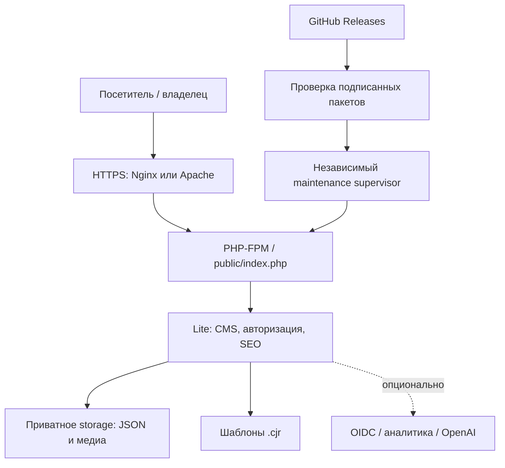

# Паспорт продукта

CajeerEngine Lite · 1.6.0

## Назначение

Lite — компактная файловая CMS для небольших сайтов на собственном сервере. Она имеет независимые ядро, схему хранения и версию; общие компоненты синхронизированы с CajeerEngine 2.1.0. Это не полная редакция CajeerEngine и не автоматическая миграция с неё.

| Сценарий | Применение |
| :--- | :--- |
| Лендинг и визитка | Публикация страниц, меню, SEO и измерение посещений |
| Портфолио | Блочный контент, изображения и медиатека |
| Небольшой корпоративный сайт | Страницы услуг, централизованное управление владельцем, подключаемая аналитика |
| Самостоятельное размещение | Контроль PHP-инфраструктуры, файлов, резервных копий и обновлений |

## Функциональная карта

| Подсистема | Возможности | Условия |
| :--- | :--- | :--- |
| CMS | Страницы, опубликованные и черновые материалы, редактор блоков, медиатека | Локальная установка |
| Шаблоны | Cajeer Template Engine `.cjr`, предпросмотр и диагностические инструменты | Изменение доверенных шаблонов отдельно разрешается на время обслуживания |
| SEO | Метаданные страниц, canonical, robots, sitemap, SEO-настройки и структурированные данные | Корректный публичный origin |
| Авторизация | Локальный пароль, SkiF4er ID OIDC, привязка владельца, сессии, logout и recovery | OIDC требует реального провайдера и настройки callback |
| Аналитика | Cookie Consent, GA4, Метрика, GTM, Clarity, Matomo, отчётность | Отдельные аккаунты, конфигурация и согласие пользователей |
| AI | Чат, генерация, редактирование с подтверждением, SEO, отчёты и диагностика | OpenAI API, ключ, сетевой доступ и контроль расходов |
| Надёжность | Блокировки, атомарное сохранение, журналы восстановления, CMS TAR и диагностика | Локальная POSIX FS и независимые копии |
| Обновления | Проверка подписей и базовых хешей, планирование, независимый supervisor, rollback | Managed trust, подходящие релизы, systemd и настроенная инфраструктура |

## Архитектура

| Каталог | Ответственность |
| :--- | :--- |
| `public/` | Единственный web document root; front controller и ресурсы |
| `core/` | CMS и прикладные подсистемы |
| `templates/` | Шаблоны сайта |
| `storage/` | Приватные данные, резервирование, служебные журналы |
| `bin/cajeer` | CLI установки, операций, диагностики и обновлений |
| `deploy/` | Примеры серверных конфигураций и supervisor |
| `tests/` | Регрессионные, HTTP, браузерные и релизные тесты |

## Границы применимости

- Один сайт на одном узле; распределённое хранилище, NFS/SMB и multi-node не поддерживаются.
- До 100 страниц (включая главную), JSON состояния не более 4 000 000 байт.
- Медиатека: до 250 файлов, 8 000 000 байт на файл, 100 000 000 байт суммарно, до 24 000 000 пикселей на изображение. HTTP upload может иметь меньший лимит.
- CMS TAR содержит JSON сайта и зарегистрированные медиа, а не полную конфигурацию сервера, ключи, шаблоны и журналы.
- Внешние провайдеры опциональны; их доступность, стоимость и соблюдение требований согласия проверяет оператор.
- Lite не позиционируется как кластерная платформа, многопользовательский портал с произвольными ролями или универсальный публичный API.

## Что означает Stable

Номер 1.6.0 обозначает стабильную линию продукта. Подпись артефакта подтверждает его происхождение в рамках доверенного ключа; тесты проверяют конкретные сценарии. Только фактическая приёмка инфраструктуры и операторский sign-off фиксируют принятие конкретного экземпляра. Это не сертификация безопасности, SLA или гарантия доступности.

[Релиз 1.6.0](RELEASE_NOTES.md) · [Установка](INSTALL.md) · [Приёмка](PRODUCTION_ACCEPTANCE.md)
